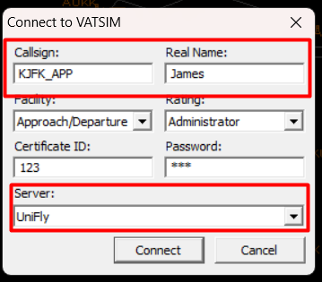
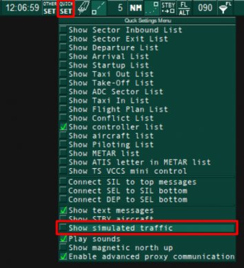
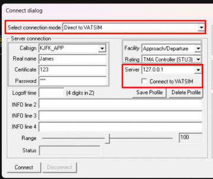

# Connecting as ATC

UniFly ATC provides an adapter between our network and popular Air Traffic Control software EuroScope and VRC. This guide demonstrates how to connect UniFly to these software.

The adapter works by creating a local network server for EuroScope and VRC to listen in to. We will configure EuroScope / VRC to listen into this local network rather than the VATSIM network.

We do not offer assistance with the installation and setup of sector files within your chosen ATC client. Please consult your ATC client's own documentation for this.

## Setting up for VRC

To setup the UniFly server in VRC, follow these steps:
1. Inside of `Documents/VRC` you will find a file named `myservers.txt`. (If this file does not already exist, create a new one with the same name)
2. Open it up with Notepad. On a new line at the bottom write `127.0.0.1 UniFly`

Now, whenever you want to connect, follow these steps:

1. Start VRC and navigate to `File -> Connect`. Populate the window as normal with your callsign and name.
2. You must fill the certificate ID and password inputs with random numbers. If you leave them empty it will not allow you to connect
3. At the bottom, select UniFly for the server. Do not connect to Vatsim. If you don't see UniFly as an option, go back to the setup stage.
4. Now, inside the UniFly Client press connect. It will detect that VRC is open and start up the adapter server on your local network. You must connect on the UniFly Client BEFORE you connect on VRC
7. Now, go back to VRC and Connect

## Setting up for EuroScope

1. Make sure EuroScope is already open, but not yet connected.
3. Make sure `Show Simulated Traffic` is disabled in Euroscope under the `Quick SET` menu

2. Start the UniFly app and press Connect on the UniFly App. You won't need to fill in a flightplan with UniFly in order to connect as Air Traffic Control. UniFly should detect that it's connecting to EuroScope and start up the adapter on your local network.
3. Now we can open the Connection dialogue on EuroScope in the top left corner.
5. Set `Select connection mode` to `Direct to Vatsim` (Don't worry, we're not actually connecting to Vatsim)
6. Set `Server` to `127.0.0.1`. (Although this field looks like a dropdown box, it will allow you to type into it.)
7. Beneath `Server`, untick the `Connect to VATSIM` checkbox
8. You must fill the certificate ID and password inputs with random numbers. If you leave them empty it will not allow you to connect.
9. Fill in the remaining details: Callsign, facility, rating, real name. 

> If you ever disconncet EuroScope from UniFly and reconnect it, then EuroScope will helpfully try to remember all of the aircraft from the previous connection. This means that if you change the UniFly server you're connecting to and reconnect EuroScope, then EuroScope might still remember pilots on the server you started with. To get around this you can fully shutdown and re-open EuroScope.

## Caveats
- Flightplans are inserted into the ATC client's every 20 seconds. This unfortunately means that any modifications you make to a pilots flightplan inside the ATC software will be overwritten every 20 seconds.
- UniFly does not yet support Squawk codes
